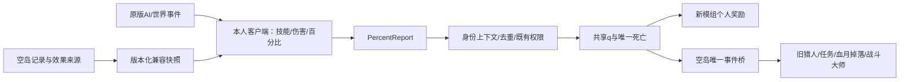

# YumisDunguenAndFight × YumisSkyIsland 程序适配方案

设计日期：2026-10-23。**本文是未来实施方案，不是兼容已经完成的证明。** 本轮未修改任何模组代码、配置或存档。

[主设计稿](README.md) · [实施清单](TODO.md)

标记含义与主稿一致：**【已确认规则】**、**【建议测试值】**、**【待设计】**。下文“当前事实”为本次只读源码调查结果；拟定接口均尚不存在。

## 1. 兼容边界与优先级

**【已确认规则】**新战斗模组独立运行；同装时保留空岛的经济、岛屿、生产、副职业、饰品解锁及累计记录。鬼剑士/剑魂与空岛副职业并存，战斗队伍与领地资产队伍并存。普通世界也运行新战斗系统，不能依赖 `SkyServer` 非空。

**【已确认规则】**本轮最新决定的战斗计算归属优先：技能、命中、位移、MP、冷却、伤害均由客户端模拟，服务器不重算或审核这些结果。原项目“服务端决定技能冷却”等约定不直接移植到新战斗系统；空岛自己的交易、背包、权限、发奖和原有技能仍按各自规则运行。百分比协议不能成为越过领地或居民权限的旁路。

**【已确认规则】**死亡无任何物品、经验或货币损失，因此共同安装时取消空岛死亡费及其递增累计；不修改历史金币和历史死亡次数。保留空岛C梯云纵、I/O/P面板、已有传送与虚空救援。

## 2. 已核实的现有入口

以下均为**当前事实**，不是新模组的已实现功能。链接使用仓库相对路径，便于后续维护者复核。

| 入口 | 当前行为 | 必要适配 |
|---|---|---|
| [通用入口 YumisSkyIsland](../src/main/java/cn/yumis/skyisland/YumisSkyIsland.java) | AFTER_DAMAGE中触发饰品、吸血、战斗大师；AFTER_DEATH中触发血月掉落、饰品、猎人/任务、死亡费；AFTER_RESPAWN恢复属性和饥饿 | 增加受管事件分支和唯一归属桥接，禁止旧回调再结算一次 |
| [Protection](../src/main/java/cn/yumis/skyisland/server/Protection.java) | 玩家攻击依领地canBuild；投射物按ENTITY_PARTY；居民有独立正式成员检查 | 百分比入口在应用共享血量前调用相同世界权限 |
| [SkyServer.playerDied](../src/main/java/cn/yumis/skyisland/server/SkyServer.java) | 空岛主世界死亡可能增加islandDeaths并扣共享金币，血月另有豁免 | 共同安装且新模组管理死亡时直接跳过扣费与增次 |
| [AccessoryService](../src/main/java/cn/yumis/skyisland/server/AccessoryService.java)、[AccessoryCombat](../src/main/java/cn/yumis/skyisland/server/AccessoryCombat.java) | 饰品加原版生命/攻击/护甲/韧性，也有额外伤害、死亡爆发等行为 | 静态来源映射、主动触发本地化、服务器仅桥接必要持久状态 |
| [FoodHealth](../src/main/java/cn/yumis/skyisland/server/FoodHealth.java) | 心之钢读取个人累计小数生命并加MAX_HEALTH修正 | 读取原记录后运行时换算，不把旧值写成新值 |
| [ModItems.applyFruitBonuses](../src/main/java/cn/yumis/skyisland/item/ModItems.java) | 果实加生命、护甲、韧性；当前部分旧职业攻击/韧性项实际为0 | 仅映射当前非零效果，不根据旧描述复活已移除加成 |
| [ItemQuality](../src/main/java/cn/yumis/skyisland/shop/ItemQuality.java) | 制造品质按原基础装备属性追加攻击/护甲，另处理耐久和不毁 | 在映射后的装备基础上只应用一次品质比例 |
| [BloodMoonService](../src/main/java/cn/yumis/skyisland/server/BloodMoonService.java)、[ModEffects](../src/main/java/cn/yumis/skyisland/effect/ModEffects.java) | 血月按状态效果改攻击、移速、攻速、吸血、敌人最大生命 | 将效果来源转换成客户端快照；原AI移动和新技能速度分开处理 |
| [CombatAdjustMixin](../src/main/java/cn/yumis/skyisland/mixin/CombatAdjustMixin.java)、[Vulnerability](../src/main/java/cn/yumis/skyisland/effect/Vulnerability.java) | hurt入口调整伤害；每层易伤+10%受到伤害 | 受管伤害在本地乘一次，应用百分比时跳过原伤害调整 |
| [SharkArmorMixin](../src/main/java/cn/yumis/skyisland/mixin/SharkArmorMixin.java)、[BloodAccessories](../src/main/java/cn/yumis/skyisland/server/BloodAccessories.java) | 指定玩家攻击来源当次减5护甲；血月专属掉落要求玩家击杀且排除额外伤害/溅射 | 新物防换算、技能归属及次级来源标记 |
| [ProfessionService.combatExperience](../src/main/java/cn/yumis/skyisland/server/ProfessionService.java) | 伤害取整、至少1点战斗大师经验；猎人和任务读取真实玩家击杀 | 按原生命尺度映射，不能直接把RPG大数字当经验 |
| [PartyService](../src/main/java/cn/yumis/skyisland/server/PartyService.java) | 加入/离开涉及领地资产与传送，不是临时战斗队 | 新队伍独立建模，不调用旧accept/leave实现战斗组队 |
| [SkyIslandClient](../src/client/java/cn/yumis/skyisland/client/SkyIslandClient.java) | I/O/P等入口、C梯云纵、右下货币/岛等级、底部飞行倒计时 | 保留入口，提供HUD避让和按键协商 |
| [DefaultKeyConflictResolver](../src/client/java/cn/yumis/skyisland/client/DefaultKeyConflictResolver.java) | 当前主要解除原版O/P/L默认冲突 | 增加独立、幂等的新冲突迁移，不假定原实现已覆盖技能键 |
| [WandClient](../src/client/java/cn/yumis/skyisland/client/WandClient.java)、[PrefabClient](../src/client/java/cn/yumis/skyisland/client/PrefabClient.java) | V建造杖设置，G重新打开已有蓝图预览定位 | V按持物分派，默认蓝图G改B |

**当前事实：**26.2本地客户端缓存JAR的 `Options` 字节码确认T聊天、F副手交换、C/X创造工具栏保存/读取激活、G快捷操作。Enter/Y/Home/End/Insert未作为该构造器的默认游戏动作键。B/N/H未在空岛源码中注册全局默认键，但有原版F3调试上下文，不得称为任何场景都空闲。

## 3. 可选桥接架构

### 3.1 装载与所有权

**【建议测试值】**双方源码都需要小范围接入，不能只依赖Mixin优先级猜测对方是否已扣血。空岛提供通用、无客户端依赖的可选桥接API及空实现；新模组仅在检测空岛存在且API兼容后，延迟加载适配器并注册战斗所有者。

**【建议测试值】**新模组对空岛API使用可选编译依赖，不把空岛JAR嵌套进新模组。缺空岛时不加载引用空岛类的适配器；缺新模组时空岛使用原逻辑。接口版本不兼容时明确报告并阻止受管战斗部分启用，不能静默走两套伤害管线。专用服不得解析客户端HUD/渲染/输入类。

**【建议测试值】**图中的服务器接收、应用和奖励不是第二次战斗模拟。世界权限不是伤害反作弊：仍允许客户端提供任意伤害比例，但不允许一支跨岛战斗队因此获得另一队居民或领地的操作权。

### 3.2 拟定接口契约

**【建议测试值】**拟定 `SkyCombatBridge` 这一概念接口，实际类名可在实现阶段按模块规范确定；下表定义必须具备的职责与输入输出，不能将其误读为当前已有API。

| 职责 | 输入 | 输出/行为 |
|---|---|---|
| 协议与能力协商 | bridgeVersion、combatOwner、双方版本 | 确定唯一战斗拥有者、支持的效果和实体类型 |
| 查询目标世界权限 | 真实玩家UUID、目标实体/维度、来源种类 | 复用Protection结果，返回允许或中文原因；不核算伤害 |
| 导出效果来源 | 个人/实体ID、效果修订 | 返回带稳定sourceId的原始增益、品质系数、血月与饰品状态 |
| 标识受管应用 | 操作ID、实体生命代次、伤害/治疗/死亡种类 | 建立作用域标记，旧hurt/吸血/伤害触发不再次执行 |
| 应用后通知 | 唯一命中回执、实际扣血比例、来源玩家和原生命尺度 | 仅转换旧经验/统计，不产生第二份伤害 |
| 唯一击杀通知 | deathId、受害类型、归属玩家、主/次级来源 | 旧任务、猎人与血月专属奖励至多调用一次 |
| 死亡保留策略 | 玩家UUID、生命代次、复活上下文 | 跳过扣费、经验掉落、物品掉落及重复恢复 |
| 救援/世界上下文变更 | 玩家、维度、岛世代、实例ID | 先处理既有救援，废弃旧生命/维度请求 |
| 客户端布局提示 | 功能键和HUD矩形数据 | 仅客户端协调；接口模型本身不引用客户端类 |

**【建议测试值】**快照带来源修订和稳定sourceId；重发只替换同来源，不叠加。读取的是原始持久记录或明确原修正来源，不扫描最终MAX_HEALTH再乘5，否则会把新模组自己的基础生命再放大。API只导出必要战斗信息，不发送空岛全量商店、钱包或个人存档。

## 4. 旧属性转换表

**【已确认规则】**保留饰品解锁、启用状态、果实数量、心之钢已吃记录及制造品质。换算发生在运行时；不覆写旧累计量，不新增历史补发。卸载新模组后，旧空岛记录仍能用于原效果。

**【建议测试值】**以下倍率为首轮调参起点，尚未实机验证，不代表旧效果的战力严格等比保留：

| 原始来源 | 新属性建议 | 示例 |
|---|---|---|
| 已识别空岛额外生命+1 | RPG生命+5 | 樱花护符+1映射+5；农夫果实每个+0.1映射+0.5 |
| 已识别空岛平加攻击+1 | 基础物攻+5 | 锐眼+0.5映射基础物攻+2.5，不直接加到最终攻击 |
| 已识别空岛额外护甲+1 | 物防+20 | 脚链+2映射物防+40 |
| 已识别空岛额外韧性+1 | 魔防+50 | 结实腰带+0.1映射魔防+5；RPG不保留独立韧性属性 |
| 心之钢小数生命累计 | 原记录合计×5生命 | 保留每种食物已吃次数和小数进度，不把显示值写回原图 |
| 制造品质attributeBonusBps | 乘映射后该件装备的相应基础属性 | 10%品质仍是该装备新基础攻击/物防的10%，不再加原攻击点数×5 |
| 百分比增益 | 对对应新属性的指定阶段应用原百分比 | 不能将+50%写成+50点 |
| 吸血x% | 本次攻击者视角实际有效伤害的x%恢复 | 按本人满血换成HEAL份额，不把怪物扣血份额直接当本人回血份额 |
| 鲨鱼当次减5护甲 | 本次物理攻击减100物防，最低0 | 不影响魔防，不改变全局目标防御，不给其他攻击者永久破甲 |

**【建议测试值】**原版铁/金/钻石/下界合金装备的基础护甲不走“每点×20”，而是直接用主稿等级装备表；这里只映射可识别的额外空岛来源。品质先从原附加修正中剥离，再对新装备基础重算；耐久/不毁按旧品质定义保留，不被战斗稀有度重置。

**【建议测试值】**新词条、战斗稀有度、空岛制造星级、职业来源标记使用不同组件。普通商品稀有度不自动变成新装备稀有度；空岛彩框继续按真实职业品质与来源判断。物品估值、出售资格和新掉落的商品登记不因战斗稀有度自动改变；新装备售卖/分解需以后单独定义，避免经济范围被兼容工作擅自扩大。

**当前事实：**本地26.2 `Attributes` 初始化的MAX_HEALTH上界为1,024，48级基础生命即超过此值。

**【建议测试值】**双端一致扩展MAX_HEALTH容纳上界至1,000,000后，再映射新生命与旧额外生命；默认值和非受管实体基础值不变。不得仅修改客户端显示，也不能将心之钢放大后的生命反写原记录。物防/魔防使用新字段，不把835新物防写成原版ARMOR。验收中同时比对RPG最大值、原生getMaxHealth、当前生命和客户端血条，防止原版范围截断。

### 4.1 血月、易伤、攻速与吸血

**当前事实：** `ModEffects` 对攻击/移速/攻速使用 `ADD_MULTIPLIED_BASE` 的0.5修正，吸血+10；敌人血月狂暴另有最大生命基数+100%，以及10层易伤。原版该修正的实际最终伤害还依赖原属性构成，不能仅凭0.5就断言旧实测伤害一定变1.5倍。

**【建议测试值】**新系统将该设计意图显式映射为基础攻击×1.5、敌人个人投影生命×2、承受伤害×2、吸血+10个百分点。移速继续保留原效果的一次应用；本地普攻/技能动作速度根据已导出攻速调整一次，不再读已经放大的速度后再乘1.5。

**【建议测试值】**血月生命、易伤、难度与人数是独立命名乘区。血月生命×2和易伤×2在有效血量上大致相抵，不删去其中一个；应连同攻击/速度/吸血实际测试。效果开始/结束更新修订，保持共享q，不通过切最大生命洗回血。已经接受的百分比不因后来状态变化重新定价。

**【建议测试值】**鲨鱼对新物理主攻击和物理技能按当次破甲解释，鬼斩转职前魔法不吃该破甲、转职后物理可吃。旧弓、三叉戟按各自已验收适配来源处理。次级饰品伤害/溅射保留原来源标记，不借新技能ID绕过旧排除条件。

**【建议测试值】**吸血以实际应用份额算有效伤害，不以过量申请量吸血：`D有效=f实际×H攻击者视角`，`回血份额=D有效×吸血率/本人最大生命`。服务器仅转发实际扣除份额，由客户端补算回血，不在服务端复算攻防。混合等级时，不能以服务器代表生命或另一个观察者的显示伤害作吸血基数。

### 4.2 触发型饰品

**【建议测试值】**主动伤害、反击、溅射、终结、死亡爆发由本机运行并提交有根施法/命中ID的次级结果；服务器旧 `AccessoryService.damaged/collect/diveBomb` 对受管事件不再额外模拟伤害。主/次级标记避免触发递归；已有解锁、消耗、冷却记录需要的持久部分通过桥接保存。

**【待设计】**逐个饰品的具体转换和正式触发矩阵须列清单验收，不能用“全部直接兼容”一句话带过。未适配的战斗饰品应清楚显示待适配而非悄悄失效；非战斗饰品继续原路径。当前方案不增加新饰品和新抽奖池。

## 5. 事件归属、旧经验与奖励

### 5.1 一次伤害只归属一个管线

**【建议测试值】**按根事件定义三层：客户端模拟伤害；服务器一次应用共享比例；桥接一次通知旧进度。服务器应用比例时不再运行旧减伤、易伤、吸血和饰品额外伤害。不要为了获得旧任务计数而再次调用hurt造成第二次生命变化。

**【建议测试值】**保留真实施法者UUID及对应 `DamageSource` 归属，范围/剑气/延迟命中仍能找回原玩家；失效或离线玩家不以随机在线玩家代替。来源绑定服务器会话身份，不接收冒充另一个账号的请求；这属于身份路由，不审核玩家自己报的伤害大小。

### 5.2 战斗大师经验折算

**当前事实：**当前 `combatExperience` 将最终伤害向下取整且至少1点。RPG攻击若直接给这个方法，会随等级/同步大幅抬高原副职业升级速度。

**【建议测试值】**受害怪物初始化时保存未经过RPG、难度和人数放大的原生基准生命 `H旧`。旧经验使用 `等价伤害=f实际×H旧`。玩家受伤用原20生命尺度，`等价伤害=本人实际掉血份额×20`；环境不伪造敌对攻击者，保留旧是否计经验的条件。累计小数后再发整点，避免多段技能每段强制至少1点造成膨胀。

**【建议测试值】**示例：新界面打1,000/10,000=10%怪物满血，原怪基准生命20，只折算2点旧等价伤害；同一次命中在别人界面显示80也不再发另一份经验。十段各0.1点旧等价伤害应总计1点，不能调用旧函数十次变成10点。需要新增桥接累计入口，不能直接把小数传给当前至少1点的方法。余数按个人持久保存。

### 5.3 一次死亡与两类队伍奖励

**【已确认规则】**新战斗队的合格成员各有个人新战斗经验和装备奖励；它不改变旧空岛队伍主线、个人任务和副职业归属。

**【建议测试值】**唯一 `deathId` 持久化包含：新个人奖励收据、旧击杀归属、旧桥接已完成步骤。旧猎人、本人击杀任务、血月专属饰品按一个归属玩家调用一次；新队友共享资格不等于旧系统八次击杀。默认归属为最终实际造成q归零的主伤害玩家；终结/次级来源依旧排除规则处理，不另创造一次死亡。

**【建议测试值】**旧公共原版材料只生成一次，猎人品质/倍数只作用原允许部分；新个人装备不继承猎人倍数、渔夫品质或制造品质。血月脚链/项链保持原每件独立0.1%的规则及原排除条件，不被新5%/45%装备池包进去。血月匣、饰品随机池和抽奖/祈愿不因本轮新增系统而重建。

**【建议测试值】**原生死亡事件和桥接需要一个共同回执所有者，防止启动恢复重发：不能同时调用一遍原AFTER_DEATH再手动重复发血月/任务。故障恢复先读已完成步骤，只续未完成发放；尚未具备该原子/回执方案时不开放共装正式服。

## 6. 死亡、居民、领地与传送

### 6.1 无损死亡

**【已确认规则】**共同安装的新战斗规则覆盖旧死亡扣费。跳过 `SkyServer.playerDied` 中金币扣减和死亡次数递增，不清历史、不补发历史损失。原版经验、战斗经验、背包/装备/副手、货币和个人进度全部保留，不创建可被重复捡回的死亡掉落。

**【建议测试值】**通过统一死亡策略实现，不仅把经济配置费用写0；写0仍可能增加死亡次数，卸载新模组后改变未来费用。优先复用原生keepInventory语义，或作用域明确的物品/经验保留钩子，不重写管理员其他游戏规则。空岛背包恢复凭据、箭库、垃圾桶状态及复活回调须与新保留逻辑配对，一份物品不能原生复制一次、事务恢复再复制一次。

**【建议测试值】**新模组负责HP/MP满值恢复，旧复活回调可重建来源但不再叠一份属性。饥饿建议复活满值；这是恢复建议，不改用户已确定的无损规则。副本死后立即入口复活，无观战、无死亡次数上限，不因全员同刻死亡重置关卡或收回已得装备。

### 6.2 保护边界

**【已确认规则】**战斗队不授予空岛建造、箱子、居民或大炮权限。百分比请求应用前仍按真实来源执行 `Protection.damage` 等同等保护；居民玩家伤害按正式本队成员规则，居民无击杀经验/战利品/任务。

**【建议测试值】**范围攻击逐目标检查既有权限，不能只检查施法者脚下领地。客户端可先用同步权限提示无法攻击，但服务端保留原世界权限决定。PVP全局关闭，反伤/溅射/TNT等间接玩家伤害也不能绕过，不把不反作弊误解为取消PvP规则。

**【已确认规则】**首版暂停怪物互打及无主怪物环境伤害。**这会影响原居民被怪物/环境杀死的路径**；不能声称居民所有生存威胁照旧。

**【建议测试值】**居民仍保持原实体、职业、皮肤、房屋和经营存档，禁止被归类为可掉装备的精英怪。允许的本人攻击可由本人客户端适配居民满血比例并走原成员权限，不发战斗奖励；没有玩家负责的怪物攻击/环境先列明确限制，不私自放回服务端伤害计算。该差异需在共装验收报告中显式记录，后续无主伤害方案另行确认。

### 6.3 维度与救援

**【已确认规则】**保留空岛三维度传送、当前home、门户、虚空救援及踏云保护。跨维度重建玩家对象不能重置本地技能冷却；新维度操作使用新上下文。

**【建议测试值】**先判定原空岛救援是否接管，再决定本地环境伤害，不能已经传到安全点后又应用原维度排队伤害。以维度、实例、岛世代、生命代次废弃旧请求；异步回调仍核对当前玩家与岛世代。战斗队退出副本的返回点不是空岛授权来源，返回位置失效走安全回退。

**【建议测试值】**新战斗技能不调用 `CloudLeapService` 的冷却或MP；C梯云纵仍按原规则在普通世界可用。建造杖/蓝图的独立UI、维度上下文和撤销记录保持原模块管理，不混入技能快捷槽的世代。

## 7. 客户端输入与HUD协调

**【已确认规则】**新技能RTZXNVFG；Ctrl/Shift/Alt各一组，32槽一次显示8槽。空岛C不动，蓝图默认G移B，V按主手太刀/建造杖分派。I/O/P现有布局不下钻、不改职业入口。

**【建议测试值】**原版迁移T→Enter、F→Y、C/X→Home/End、G→Insert，与蓝图G→B在同一次输入初始化协调，读取旧配置后幂等执行。只改默认冲突；目标被占用时不覆盖，显示原动作/冲突键/建议新键。玩家自定键仍可通过按键设置改技能，不能每次启动再强制恢复。F3+N/C/B等调试上下文不得触发技能、梯云纵或蓝图。

**【已确认规则】**生命放原版爱心位置，魔力在饥饿上方，左下战斗经验，左上目标；原版经验条保留。

**【建议测试值】**共享布局矩形而不是互相修改私有HUD坐标：新技能栏上移避开MP与呼吸条，空岛飞行倒计时再放技能栏上方；右下货币与岛等级保留。原金币收入浮字、心之钢食用提示、聊天、品质边框和原版物品数量/耐久层分别验证。原生生命图标仅在新HUD接管时隐藏，不能在登录断连没有RPG快照时空白。

## 8. 共装验收矩阵

**【建议测试值】**以下是未来必须执行的验收要求，本轮只有源码核对和文档验算，没有运行新模组测试。

| 场景 | 必须观察的结果 |
|---|---|
| 新模组单装：集成服、专用服、普通世界 | 无SkyServer仍可升级/战斗；专用服不加载客户端类 |
| 空岛单装，未安装新模组 | 原属性、死亡费用、按键和奖励保持原行为 |
| 双方安装/API版本不兼容 | 明确拒绝不完整战斗桥接，不同时运行两条伤害管线 |
| 10级与50级共同攻击，同步开/关混合 | q一致、个人血量不同，服务器无攻防公式执行 |
| 同刻过量伤害、重传、重连、实体ID复用 | 一次死亡、一次奖励，过期生命代次不伤新实体 |
| 血月开始/结束、重登、换维度 | 一份血月效果，无重复生命/攻速/易伤和吸血 |
| 脚链/鲨鱼、鬼斩转职前后、箭/次级溅射 | 物理破甲只作用本次、主次来源排除正确 |
| 制造星级＋战斗稀有度＋换装 | 两套标记独立，品质只乘装备一次，彩框不认商品稀有度 |
| 心之钢小数增益、果实、饰品重建 | 原存档数值不变，新属性只映射一次 |
| 47/48/50级及额外生命 | 双端实际生命容纳超过1,024，与UI一致，无原版属性范围截断 |
| 10段小伤害与一段同总伤害 | 旧战斗大师余数累计一致，不因每段至少1点膨胀 |
| 一次技能击杀＋8人队伍分享 | 新个人奖励按资格发，旧猎人/任务/血月不复制8次 |
| 普通死亡、血月死亡、同刻全员副本死亡 | 无扣费/掉物/掉经验，副本入口立即复活，关卡不因全灭重置 |
| 跨岛组队、访客攻击居民、范围斩跨界 | 战斗队不改变Protection和正式队员权限 |
| 无主日晒/岩浆、怪物互打、怪物攻击居民 | 明确符合首版暂停限制，无隐藏服务端代算 |
| 地狱/末地救援与旧维度延迟请求 | 先救援，旧请求不伤当前新生命 |
| 1280×720/1920×1080、多GUI缩放、水下/聊天 | 技能、MP、呼吸、飞行提示、金币浮字互不遮挡 |
| 5/20/50人，8人幻影剑舞/暴风式 | 记录包数、字节、帧时间与tick，不能只报告公式耗时 |
| 死亡持久化、背包恢复、奖励桥接中断 | 重启后不丢已承诺奖励、不重复扣物或发物 |

## 9. 实施边界

**【已确认规则】**本轮只交付文档。未来空岛修改限于已列接口和冲突，不借机重做商店、居民经济、抽奖或副职业体系。

**【建议测试值】**先以单装白装战斗验证百分比协议，再完成可选桥接后共装验收。空岛无主伤害限制、尚未映射的饰品/原版武器和未定义奖池必须进入发布说明，不能用“注册成功/编译成功”代替实际运行验收。未通过共装验收前，两模组不进入正式共装发布阶段。
