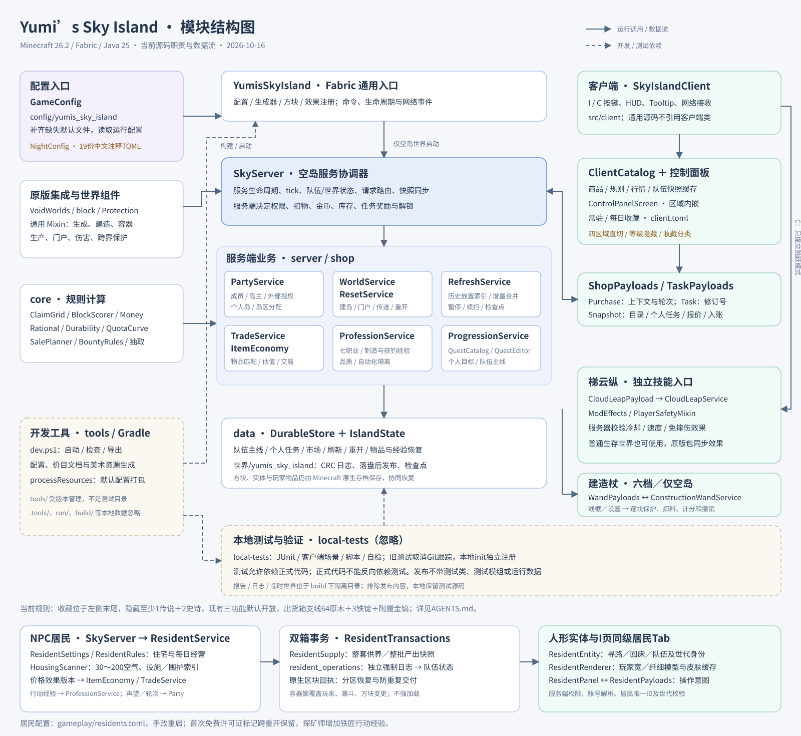
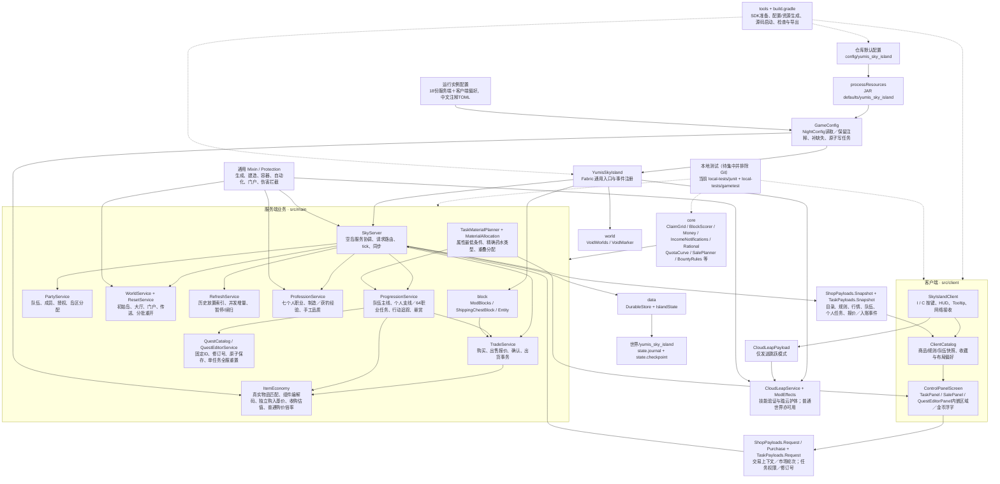
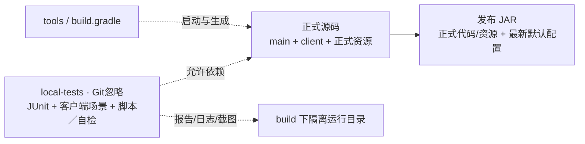

# Yumi’s Sky Island 模块结构图

更新于 2026-10-14，按当前源码绘制。开发必须遵守的最新要求见 [AGENTS.md](../AGENTS.md)；下图展示当前TOML、历史放置索引、单页控制面板、指令控制编辑、个人职业追踪、金币入账提示和本地测试隔离的实现。



[打开 SVG 原图](MODULE_STRUCTURE.svg)。实线表示运行调用或数据传递，虚线表示开发工具/测试依赖。图中按职责归组，不表示每个类只能调用相邻模块。

## 运行模块与调用关系

以下 Mermaid 源图便于随源码修改。`CloudLeapService` 的网络接收器独立注册，普通生存世界也能使用；`SkyServer` 只在空岛世界启动。



## 目录与源码入口

```text
YumisSkyIsland/
├─ AGENTS.md                         全仓库开发规则与最新要求
├─ build.gradle / gradle.properties   Loom、依赖、源集、默认配置打包
├─ config/yumis_sky_island/           仓库默认业务配置；当前 JSON，目标 TOML
│  ├─ server_rules.*                 原版交易限制
│  ├─ shop/                          商品、价格、稀有度、等级、库存、售出额度
│  ├─ islands/                       方块计分、等级阈值、刷新预算
│  ├─ products/                      职业、手工商品资格、制造品质
│  ├─ tasks/                         成长任务、悬赏
│  └─ automation/                    核心购买门槛、生产设计、出货箱资料
├─ src/main/java/cn/yumis/skyisland/
│  ├─ YumisSkyIsland.java             通用入口
│  ├─ config/                        配置加载与规则模型
│  ├─ core/                          可复用的计算与领域规则
│  ├─ server/                        队伍、世界、刷新、重开、职业、任务、技能
│  ├─ shop/                          商品编解码、估值、交易与恢复
│  ├─ data/                          模组状态与持久日志
│  ├─ network/                       客户端请求和服务端快照协议
│  ├─ world/                         空生成器标记与注册
│  ├─ block/                         出货箱方块与方块实体
│  ├─ effect/                        踏云护体状态效果
│  └─ mixin/                         原版行为拦截及必要存储访问
├─ src/main/resources/               Fabric、Mixin、配方、世界生成、语言与贴图
├─ src/client/java/cn/yumis/skyisland/client/
│  ├─ SkyIslandClient.java            客户端入口
│  ├─ ClientCatalog.java              服务端快照缓存与本地偏好
│  ├─ ControlPanelScreen.java         单页控制面板
│  ├─ SalePanel.java                  内嵌出售预览／确认
│  ├─ TaskPanel.java                  任务／悬赏区域
│  ├─ QuestEditorPanel.java           内嵌编辑与物品搜索
│  ├─ ItemPickerCatalog.java          完整有效注册物品与变体
│  └─ mixin/                         HUD、Toast、稀有度名称展示
├─ src/client/resources/             客户端 Mixin 描述
├─ local-tests/junit/                         本地JUnit，Git忽略
├─ local-tests/gametest/                     本地客户端场景，Git忽略
├─ tools/                            受版本管理的启动、配置与资源生成工具
├─ art/                              可编辑 Aseprite 美术源
├─ server-template/                  服务器安装说明与 properties 示例
├─ docs/                             结构图、设计、运行说明、验证记录与截图
├─ .tools/                           忽略：本地 SDK、元数据与备份
├─ run/                              忽略：开发客户端配置和世界
└─ build/                            忽略：编译产物、报告、隔离测试运行数据
```

`*` 表示配置逻辑分组，默认文件已经是带逐字段中文注释的TOML。默认配置与各运行实例的配置是不同文件，不能假定修改仓库配置会覆盖正在运行的实例。

| 模块 | 当前职责 | 修改入口 |
|---|---|---|
| 通用入口 | 初始化配置/方块/效果/生成器，注册命令、事件与网络接收器 | [YumisSkyIsland.java](../src/main/java/cn/yumis/skyisland/YumisSkyIsland.java) |
| 配置 | 补齐缺失默认文件、读取商品/计分/额度等配置、NightConfig读取、JSON导入、注释保留与原子保存 | [GameConfig.java](../src/main/java/cn/yumis/skyisland/config/GameConfig.java)、[默认配置目录](../config/yumis_sky_island) |
| 规则计算 | 半开领地、递减计分、64位金币、有理数、耐久、额度、销售规划、随机抽取、稀有度颜色 | [core](../src/main/java/cn/yumis/skyisland/core) |
| 服务端协调 | 仅在空岛世界启动，管理服务、服务器 tick、持久变更回调、目录和队伍快照 | [SkyServer.java](../src/main/java/cn/yumis/skyisland/server/SkyServer.java) |
| 队伍与保护 | 成员/岛主/外部授权、个人岛休眠、实际领地归属与自动化跨界限制 | [PartyService.java](../src/main/java/cn/yumis/skyisland/server/PartyService.java)、[Protection.java](../src/main/java/cn/yumis/skyisland/server/Protection.java) |
| 世界与重开 | 大厅、初始岛、异步安全传送、门户路由、分批清理与恢复 | [WorldService.java](../src/main/java/cn/yumis/skyisland/server/WorldService.java)、[ResetService.java](../src/main/java/cn/yumis/skyisland/server/ResetService.java)、[world](../src/main/java/cn/yumis/skyisland/world) |
| 计分刷新 | 每岛世代的历史放置索引、异步读取、区段计数、并发增量、任务暂停与续扫 | [RefreshService.java](../src/main/java/cn/yumis/skyisland/server/RefreshService.java)、[BlockScorer.java](../src/main/java/cn/yumis/skyisland/core/BlockScorer.java) |
| 经济与交易 | 真实注册表/组件匹配、行情、耐久/品质/附魔估值、日库存、额度、背包报价与确认、出货和恢复 | [ItemEconomy.java](../src/main/java/cn/yumis/skyisland/shop/ItemEconomy.java)、[TradeService.java](../src/main/java/cn/yumis/skyisland/shop/TradeService.java) |
| 职业与品质 | 手工结果预备/提取结算、个人经验、品质与自动化隔离 | [ProfessionService.java](../src/main/java/cn/yumis/skyisland/server/ProfessionService.java) |
| 成长任务与悬赏 | QuestCatalog／QuestEditorService全服编辑、属性材料分配、本人行动计数、独立功能与个人放置支线、独立悬赏格、首获状态 | [ProgressionService.java](../src/main/java/cn/yumis/skyisland/server/ProgressionService.java)、[BountyRules.java](../src/main/java/cn/yumis/skyisland/core/BountyRules.java) |
| 出货箱 | 方块/实体注册、归属和世代绑定、红石上升沿、与交易服务衔接 | [block](../src/main/java/cn/yumis/skyisland/block) |
| 梯云纵 | 独立网络接收、服务器冷却/速度检查、踏云护体，借原版效果包同步 | [CloudLeapService.java](../src/main/java/cn/yumis/skyisland/server/CloudLeapService.java)、[ModEffects.java](../src/main/java/cn/yumis/skyisland/effect/ModEffects.java)、[PlayerSafetyMixin.java](../src/main/java/cn/yumis/skyisland/mixin/PlayerSafetyMixin.java) |
| 网络 | `ShopPayloads` 请求/JSON 快照；`CloudLeapPayload` 只发送跳跃模式 | [network](../src/main/java/cn/yumis/skyisland/network) |
| 持久化 | `IslandState` 保存队伍/玩家/市场/刷新/重开/任务等状态；`DurableStore` 用 CRC 日志和检查点，落盘后发布 | [IslandState.java](../src/main/java/cn/yumis/skyisland/data/IslandState.java)、[DurableStore.java](../src/main/java/cn/yumis/skyisland/data/DurableStore.java) |
| 客户端 | 按键、HUD、稀有度/估值提示、目录缓存、单页控制面板、独立收藏分类、内嵌出售／任务编辑／搜索、确认浮层 | [client](../src/client/java/cn/yumis/skyisland/client) |
| 原版集成 | 世界生成、方块变化、容器/生产结果、交易限制、门户、伤害和实体/区块存储访问 | [通用 Mixin](../src/main/java/cn/yumis/skyisland/mixin)、[客户端 Mixin](../src/client/java/cn/yumis/skyisland/client/mixin) |
| 开发工具与测试 | SDK准备、配置/文档/贴图生成、源码启动与导出；JUnit及真实客户端场景单独编译 | [tools](../tools)、[build.gradle](../build.gradle)、[local-tests/junit](../local-tests/junit)、[local-tests/gametest](../local-tests/gametest) |

## 三条关键数据链路

1. **购买/手动出售**：客户端勾选或购买请求 → `ShopPayloads.Request` → `SkyServer` → `TradeService` → `ItemEconomy` 与 `core` 核价/校验 → `DurableStore` 落盘 → 背包/钱包结果交付 → 服务端快照回客户端。手动出售预览不能扣物，确认时须再次校验。
2. **计分/刷新**：原版方块变化 → Mixin → `SkyServer.blockChanged` → 当前存量与最高等级更新；`/refresh` → `RefreshService` 分批读取/扫描 → 合并并发增量 → 检查点与完成快照。刷新只读历史放置索引，飞行／加载不登记，零分放置与拆空保留；重开继续使用完整地形和实体索引。
3. **任务/悬赏**：客户端领取请求 → `SkyServer` → `ProgressionService` 检查队伍、任务/悬赏版本和材料 → `TradeService.commitInventory` 原子处理材料（仅提交型）、物品/经验奖励、金币、实际所有者的完成状态与解锁 → 同步结果。制造、熔炼领取、钓鱼、本人采集掉落与击杀事件进入ProgressionService，只更新当前解锁目标。管理员编辑模式仅由指令控制，编辑使用独立协议及原子保存，任务与功能记录分开；现有三个功能默认开放。

## 配置与存档边界

| 数据 | 当前位置 | 权威与约束 |
|---|---|---|
| 仓库默认业务配置 | `config/yumis_sky_island` | 逐字段中文注释TOML |
| 打包默认配置 | JAR `defaults/yumis_sky_island` | `processResources` 打包最新TOML默认值 |
| 运行配置 | 实例 `config/yumis_sky_island`；开发实例在 `run/config/yumis_sky_island` | 当前 `GameConfig` 只复制缺失文件，不能无条件覆盖改价 |
| 客户端偏好 | 客户端 `config/yumis_sky_island/client.toml` | 收藏与格子大小，本地保存；也需迁移 TOML |
| 队伍与模组运行状态 | 世界目录 `yumis_sky_island/state.journal`、`state.checkpoint` | 服务端持久化，不能当作可编辑配置或 Git 源文件 |
| 方块、实体、玩家物品 | Minecraft 原生世界/玩家存档及附件 | 与模组日志共同参与恢复，不由默认配置替代 |
| 阅读表与设计资料 | `docs` 及配置目录内的 Markdown | 文档说明；直接修改价目 MD 不改变运行价格 |

`automation/production.toml` 与 `shipping_chest.toml` 当前还包含设计资料，并非每个字段都有运行绑定。Fabric、Mixin、原版配方、语言与世界生成资源继续按原规范使用 JSON，不属于 TOML 业务配置迁移范围。

## 开发和测试边界



正式源码不得反向依赖测试；发布不带测试代码、测试模组、测试依赖或测试运行数据。本地测试保留并集中到一个根目录，同时从 Git 排除；原测试已取消Git跟踪，正式构建不加载本地测试init脚本。`tools` 是开发工具，`.tools` 是被忽略的本地 SDK，不能混为一谈。

## 已确认规则与实现入口

| 规则 | 实现入口 | 状态 |
|---|---|---|
| 中文注释TOML | GameConfig、TomlConfigIO、ClientCatalog、config_io、默认资源打包与导出校验 | 已迁移19份；人工值和注释保留 |
| 历史放置刷新／草层 | IslandState、方块变化入口、RefreshService、WorldService | 持久索引分世代，36草＋180泥土 |
| 单页控制面板／收藏／等级 | ControlPanelScreen、TaskPanel、SalePanel、ClientCatalog | 四区域直接切换，收藏左侧分类，默认隐藏未解锁 |
| 指令控制任务编辑／追踪／属性／重置 | QuestEditorPanel、ItemPickerCatalog、TaskPayloads、QuestEditorService、QuestCatalog | 校验模式、权限、修订，原子保存，全服单任务重置 |
| 独立功能权限 | ProgressionService、IslandState、QuestCatalog.features | 现有三功能默认开放；未来锁定功能仅任务授予 |
| 完整物品材料与奖励 | TaskMaterialPlanner、MaterialAllocation、ItemQuality | 不依赖交易目录，最低属性／精确药水／重叠分配，品质幂等 |
| 隐藏保底与库存 | DailyShopSelector.rollShop、TradeService、ShopPayloads.Purchase | 至少1传说＋2史诗，向下回退、不重复、上下文及轮次校验 |
| 出货箱支线 | ShippingChestBlock.setPlacedBy、ProgressionService.shippingPlaced | 本人于本队实际成功放置；64原木＋3铁锭＋附魔金镐 |
| 本地测试隔离 | local-tests、build.gradle、dev.ps1、.gitignore | 已集中取消跟踪；用户已接手后续实机验收 |

模块或数据流改变时，同时维护本文 Mermaid、SVG 和 [AGENTS.md](../AGENTS.md) 的对应规则/状态，避免结构图与代码脱节。

收藏分常驻、每日／隐藏两组，均位于左侧分类末尾；未抽到的每日收藏库存0。隐藏先保证至少1传说、2史诗，再加权补齐，逐格向低稀有度回退，普通商品也限库存。现有悬赏、特殊商店、出货箱默认开放；无前置出货箱支线奖励64橡木原木、3铁锭和全新耐久IV／效率V金镐。

正式构建没有测试依赖；所有测试代码、场景和自检由被忽略的local-tests区管理。最新实际验证和用户接手范围见[交付记录](CONTROL_PANEL_DELIVERY.md)。

## 2026-10-14职业任务与购价修订

主线进度留在Party，个人支线、职业目标计数／完成／重置版本在Person；换队和重开保留个人进度。QuestCatalog验证7职业与显式前置链，三类稳定排序；服务器行动钩子只推进当时已解锁任务，个人明细及计数进入快照。原版经验奖励与背包使用同一事务恢复凭据。

GameConfig.Product独立保存buyBaseCoins与baseCoins，普通额外倍率按交易上下文应用。SkyServer在持久事务中捕获共享钱包正增量，落盘后通知本队在线成员；IncomeNotifications固定200ms合并并防重复，游戏HUD与控制面板绘制1.8秒上浮提示。
